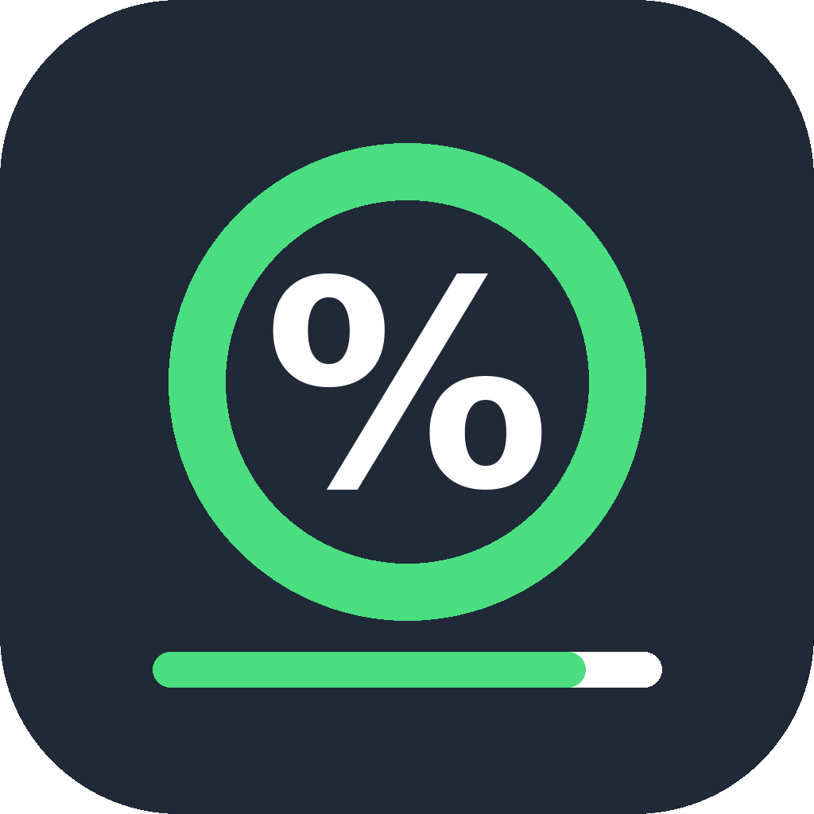

# MuseQuotaWidget



一个桌面悬浮窗，实时显示 Muse 的周剩余额度。Python + PySide6，macOS / Windows 通用。

悬浮窗上只显示一个周额度剩余百分比和一条进度条：低于 50% 变黄，低于 20% 变红，条的颜色跟百分比一致；下面一行是每周额度重置时间（已转成本地时间，格式 `MM-dd HH:mm`）。不显示标题、计划、已用百分比、额外词元等其他字样，也不在悬浮窗上显示你的账号。

## 功能

- **实时额度，不是手动填数**：内置登录后直接读 Muse 的额度接口，默认每 5 分钟刷新一次。
- **用量节奏**：主条下方有一条节奏控件，只回答“比平均快还是慢”。周期按 7 天计，起点 = 重置时间 − 7 天；白点是你的实际偏差（已用% − 平均应为%），偏左慢、偏右快。快的时候写“预计 MM-dd HH:mm 用完”，慢的时候写“预计重置时还剩 X%”，预计日期永远不会超出重置时间。预计是按当前速度外推的，速度一变它就变。
- **三种状态，没有托盘**：启动时不出现系统托盘图标，也不进任务栏，退出只走设置面板里的“退出软件”。
  1. 隐藏最小：贴在屏幕边上的 96×48 小条，只有一个百分比，颜色按使用快慢决定（慢绿、持平黄、快橙、很快红）；
  2. 鼠标靠近小条：240 宽的中等窗（百分比 + 进度条 + 节奏 + 重置时间）；
  3. 点齿轮：最大的设置窗（上方百分比 + 进度条，下方设置块）。
- **边缘隐藏**：窗体永远拖不出屏幕，拖动全程按所有屏的虚拟外框钳制，双屏之间可以自由拖过去；屏间交界不算边，拖过交界不会变小条。拖到某屏真正的边上松手，就自动变成贴边小条；鼠标划过小条完整展开，鼠标离开完整窗体又变回小条；把展开后的窗体拖离边缘就取消隐藏。设置展开时鼠标离开不触发隐藏，但拖动到边缘松手也能隐藏到小条；小条划过展开成完整窗体、点齿轮展开设置、再点齿轮收起设置后，若原来是小条来的，会一次形变直接回到小条。
- **设置面板**：鼠标悬停到悬浮窗上时右上角出现齿轮按钮（平时不显示），点它展开，再点一次收起。设置块无明显边框，上下中间只有一条不到边的细线隔开，里面只有：登录 / 退出登录（只显其中一个）、刷新数据、刷新频率滑块（1–60 分钟，拖动立即生效并保存，默认 5 分钟）、退出软件。窗体默认始终置顶，没有关掉它的开关。

## 快速开始

需要 Python 3.10+。先装依赖，再启动：

```bash
# 克隆
git clone https://github.com/97Rzh/MuseQuotaWidget.git
cd MuseQuotaWidget

# 装依赖（Mac 用 python3，Windows 用 python）
# 注意：PySide6 6.12 起已拆包，只装 PySide6 不含 WebEngine，
# 必须同时装 PySide6-WebEngine，否则登录窗不可用。
python3 -m pip install -r requirements.txt

# 启动（Mac 也可以 ./run.sh，Windows 也可以双击 run.bat）
python3 main.py
```

首次使用：点齿轮 → “登录 Muse…” → 在内置浏览器窗口里登录 muse.ai → 点“验证登录并读取额度”。只有在真实额度响应通过解码后窗口才会关闭并显示额度；失败时窗口保持打开，可重试。

之后每次打开不用再点登录：启动时悬浮窗会在后台自动登录，用上次登录留下的 Cookie，在一个移到屏幕外的后台浏览器窗口里加载 muse.ai 并静默换令牌，成功就直接显示额度。令牌本身仍只存内存，重启后丢了也不要紧，后台登录会用 Cookie 再换一个。只有 Cookie 已过期、被清除或 Muse 要求重新验证时，后台登录才会失败，那时悬浮窗显示“未登录”，点齿轮 → 登录一次即可。

点齿轮 → “退出登录”只清内存里的令牌，网页登录 Cookie 仍在浏览器数据文件夹中；彻底退出请手动删除该文件夹（见下面“本地文件”）。

## 打包

打包产物没有签名，第一次打开会被系统拦截，属正常现象。

### macOS（.app）

必须在 Mac 上跑：

```zsh
./build_mac.sh
```

这一步会装依赖和 PyInstaller，再用 macOS 自带的 `iconutil` 把 `assets/icon.iconset/` 转成 `assets/icon.icns`，最后用 PyInstaller `--windowed` 打出 `dist/MuseQuotaWidget.app`，可直接拖到“应用程序”里双击打开。不要用 `--onefile`：QtWebEngine 的子进程要跟 .app 放在一起。

第一次打开被 Gatekeeper 拦时，右键点 .app → “打开” → 再点“打开”，或者跑 `xattr -cr dist/MuseQuotaWidget.app` 后再双击（只对你自己刚打出的这个 .app 用）。

### Windows（.exe）

在 Windows 上跑（双击文件资源管理器里的 `build_windows.bat` 也行，脚本会自动切到自己所在的目录）：

```powershell
.\build_windows.bat
```

这一步会装依赖和 PyInstaller，再用 PyInstaller `--windowed` 打出 `dist\MuseQuotaWidget\MuseQuotaWidget.exe`。同样不要用 `--onefile`：`dist\MuseQuotaWidget\` 整个文件夹就是程序，exe 不能单独拷走。第一次打开被 SmartScreen 拦时，点“更多信息”再点“仍要运行”。

开机自启不在软件内：Windows 可把打包后的 exe 快捷方式放进启动文件夹，macOS 可在系统设置的登录项里添加 .app。

## 它是怎么读到额度的

思路参照 [HuiAnnn/ai-quota](https://github.com/HuiAnnn/ai-quota) 里 Muse 那部分（macOS Swift + WKWebView），这里用 QtWebEngine 重写，Swift 代码没有直接复制：

```
点齿轮 → “登录 Muse…” → 内置 QtWebEngine 窗口打开 muse.ai
  → 用户在窗口里登录 → 点“验证登录并读取额度”
  → 窗口内同源 POST /api/auth/check 换一个访问令牌
  → 悬浮窗用该令牌 GET https://hatch-api.meta.ai/hatch/subscription
    （Authorization: Bearer 令牌，X-API-Version: 1.0.0，不带 Cookie，
    不请求 include=agreement，不碰支付与协议详情）
  → 按刷新频率用同一令牌刷新，直到令牌失效
```

- 登录在应用自己的浏览器数据文件夹里完成，不用系统浏览器、不用 Muse 原生应用的登录状态。
- **令牌只存在内存里**，绝不写盘、绝不进日志、绝不发给除 hatch-api 之外的任何主机；令牌与账号指纹（SHA256(viewer_id + session_binding_id)）成对核对，指纹变了就视为换号并丢弃令牌。
- 读额度接口本身不是对话，不产生对话 token。刷新失败时继续显示内存里的上次成功快照；登录失效或换号时清令牌并提示重新登录。过于频繁刷新可能触发限流，建议 5 分钟以上。

## 本地文件

设置文件只存刷新分钟数，不存账号与令牌。

| 内容 | macOS | Windows | Linux |
| --- | --- | --- | --- |
| 设置与日志 | `~/Library/Application Support/MuseQuotaWidget/settings.json`、`muse-debug.log` | `%LOCALAPPDATA%\MuseQuotaWidget\settings.json`、`muse-debug.log` | `~/.local/share/MuseQuotaWidget/`（或 `$XDG_DATA_HOME`） |
| 浏览器数据（含登录 Cookie） | `~/Library/Application Support/MuseQuotaWidget/QtWebEngine` | `%LOCALAPPDATA%\MuseQuotaWidget\QtWebEngine` | `~/.local/share/MuseQuotaWidget/QtWebEngine` |

诊断日志里只有字段名、字段类型、HTTP 状态、outcome / type / reason / state 这类状态词，**没有令牌、没有账号 id、没有百分比与余额**。定位问题时可以先看最后一行是 `auth:` 还是 `quota invalid:`，就知道是登录检查还是额度读取那一步的返回体结构对不上。

## 常见问题

- **登录窗报 QtWebEngine 不可用**：不要只重装 PySide6。PySide6 6.12 起已拆包，基础包不含 WebEngine，要单独装 `PySide6-WebEngine`（Mac 上那个轮子约 250MB，装的时候要等一会儿），装完重启悬浮窗再登录。主悬浮窗仍能打开、只显示“未登录”，额度要等登录可用后才能读取。
- **一直显示“未登录”**：通常是 Cookie 已过期、被清除或 Muse 要求重新验证，点齿轮 → 登录一次即可。
- **刷新失败**：悬浮窗会继续显示上次成功快照，时间行只写短提示，不拿旧数据冒充新数据；等下一次定时刷新再试。
- **打包版里登录不可用**：先确认打包时装的是最新版 PyInstaller，再把报错贴出来。

## 免责声明

本项目与 Meta / Muse 没有任何关联，也不是 Muse 的官方客户端。它调用的是 Muse 网页端目前使用的、未公开的接口，Muse 改动接口后本项目可能随时失效。你的 Muse 账号、密码和令牌只在你自己的机器上使用，不经过任何第三方服务器；请不要把诊断日志以外的任何凭据发给别人。

## 文件结构

```
main.py                  # 入口
requirements.txt         # PySide6 + PySide6-WebEngine
run.sh / run.bat         # Mac / Windows 启动脚本
build_mac.sh             # macOS 打包脚本
build_windows.bat        # Windows 打包脚本
assets/                  # 图标（icon.png / icon.ico / icon.iconset，make_icon.py 可重画）
muse_quota_widget/
  paths.py               # 平台本地路径（设置、日志、浏览器数据）
  diagnostics.py         # 本地诊断日志（不记令牌与账号 id）
  quota_api.py           # hatch-api 响应解码 + 令牌指纹
  muse_session.py        # 内存会话 + hatch-api 直连（令牌不存盘）
  settings_store.py      # 刷新频率本地设置（只存分钟数）
  pace.py                # 用量节奏纯计算（与界面无关）
  pace_widget.py         # 节奏刻度手绘控件（渐变 + 白线 + 白点）
  web_auth.py            # 网页登录换令牌共用逻辑（可见窗与后台窗共用）
  webengine.py           # QtWebEngine 懒加载 + 共享持久化 Profile
  login_window.py        # 内置 QtWebEngine 登录窗口 + /api/auth/check
  background_login.py    # 后台自动登录（离屏浏览器窗，复用 Cookie）
  main_window.py         # 悬浮窗 + 齿轮设置面板 + 边缘隐藏 + 额度刷新线程
```

## 许可证

MIT，见 [LICENSE](LICENSE)。
